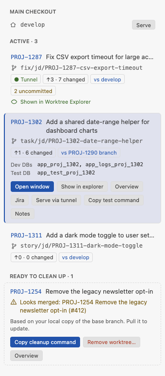
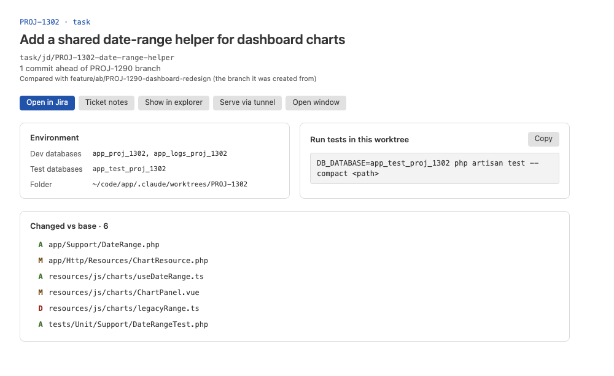

# Worktree Explorer

A VS Code extension that adds a secondary Explorer view bound to one selected Git linked
worktree — browse, open, create, rename, and delete files in it — **without** adding that
worktree to your workspace.

Git worktrees let you check out several branches of one repository at once. VS Code can already
discover them in Source Control, but the built-in File Explorer stays tied to your workspace
folders. Worktree Explorer gives you a native, familiar file tree for another worktree — the one
selected in Source Control, or one you pick manually — while your current workspace, tasks,
search, and language tooling stay exactly as they are.

## Screenshots

<table>
<tr>
<td valign="top" width="34%">
<picture>
  <source media="(prefers-color-scheme: dark)" srcset="https://github.com/seanc/vscode-worktree-explorer/raw/HEAD/docs/images/tickets-sidebar-dark.png">
  
</picture>
</td>
<td valign="top">
<picture>
  <source media="(prefers-color-scheme: dark)" srcset="https://github.com/seanc/vscode-worktree-explorer/raw/HEAD/docs/images/ticket-overview-dark.png">
  
</picture>
</td>
</tr>
</table>

The **Tickets** sidebar (left) and the **ticket overview** tab (right). Shown with sample data; they
follow your VS Code theme.

## How it works

- **Follows Source Control automatically.** Select a linked worktree's repository in the Source
  Control view and Worktree Explorer appears, rooted at it. Select the main repository (or nothing
  linked) and it hides again.
- **Manual override.** Use the **Select Worktree** action (view title, or Command Palette) to open
  any discovered linked worktree directly. A manual choice stays active until Source Control
  selection changes.
- **Browse, open, create, rename, delete.** Standard Explorer-like interactions, scoped strictly to
  the active worktree.
- **Never touches your workspace.** The active worktree is never added to
  `workspace.workspaceFolders` or any `.code-workspace` file — this is a browsing/editing surface,
  not a second workspace, and multi-root side effects (search, tasks, extension activation) never
  apply to it.

## Ticket workflow

For one-worktree-per-ticket setups, the extension also reads ticket context locally — no tracker
API, no network:

- **Ticket key** from the branch name (for example `fix/PROJ-123-short-name`), then the worktree
  folder name. Pattern: `worktreeExplorer.ticket.keyPattern`.
- **Summary, ticket link, databases, and test command** from an optional notes file in the worktree
  root (`worktreeExplorer.ticket.notesFile`, default `CLAUDE.local.md`), in this shape:

  ```markdown
  # PROJ-123: Short summary
  - Jira: https://your-site.atlassian.net/browse/PROJ-123
  - Dev databases (clones): `app_proj_123`
  - Test databases: `app_test_proj_123`
  - Tests: `DB_DATABASE=app_test_proj_123 php artisan test --compact <path>`
  ```

  Links are only used if they are `https`, point at `/browse/<KEY>` for the same key, and are on
  an Atlassian Cloud host or the host of `worktreeExplorer.ticket.urlTemplate`.
- **Ahead count and changed files** against the base branch, measured from the merge base. The base
  is the branch this one was created from (read from Git's reflog, so stacked branches compare
  against their parent), else `worktreeExplorer.baseBranch`, else the first of `develop`, `main`,
  `master`.
- **Ready to clean up**: a ticket looks merged when a commit on its base branch since the split
  mentions its key (squash or merge commits). This uses your local copy of the base branch.

With that, the Worktree Explorer header shows `KEY · ↑N vs base` and the summary; a filter shows
only files changed against the base branch or uncommitted files; a **Tickets** sidebar in the
activity bar shows every linked worktree as a ticket card, with merged tickets under **Ready to
clean up**; and a **ticket overview** tab shows environment, test command, and changed files (click
one to compare with the base). Test and cleanup commands are only ever copied to the clipboard,
never run. **Remove worktree…** asks for confirmation, then removes the worktree folder through
VS Code's Git extension (never forced, so Git refuses one with uncommitted or untracked files; the
branch is kept).

**Optional tunnel support.** Set `worktreeExplorer.tunnel.siteLink` to a symlink that points at the
served checkout (for example a Herd site link) and `worktreeExplorer.tunnel.serveCommand` to your
serve script with a `{target}` placeholder (a ticket key, or `main`). The served checkout gets a
"● Tunnel" badge, and other cards get **Serve via tunnel**, which asks for confirmation and runs
the command in a new terminal. Both settings are read from user settings only.

The Tickets sidebar and overview are webviews. They load only the extension's own `media/` files
under a strict Content-Security-Policy (no remote content, scripts by nonce), render ticket data as
text only, and accept only a fixed set of actions on worktrees the extension itself discovered.

## Scope and limitations

This is intentionally smaller than a second full VS Code workspace:

- Local filesystem repositories and linked worktrees only.
- Requires VS Code's built-in Git extension (bundled with VS Code by default).
- Does not create, move, prune, or lock Git worktrees. The only worktree it removes is one you
  confirm with **Remove worktree…**.
- No staging, committing, merging, rebasing, or branch management.
- No drag-and-drop, copy/cut/paste, or multi-selection operations.
- No Git status decorations (changed-file status is shown as text), **no telemetry**
  — nothing ever leaves your machine. The one outward action is opening a validated ticket link
  in your browser when you ask for it.

See [`docs/PRD.md`](docs/PRD.md) §5 for the complete list of non-goals and §32 for ideas
deliberately kept out of this first release.

## Safety

Every file operation is validated by a single shared boundary guard before it touches disk:

- Mutations can never escape the active worktree root (path traversal and symlink-escape targets
  are rejected).
- The worktree root itself and Git administrative paths (`.git`) can never be renamed or deleted.
- Commands re-validate the active worktree immediately before mutating, so a worktree switch that
  happens mid-operation aborts it instead of writing to the wrong place.
- Mutating commands are disabled by default in untrusted workspaces (browsing and opening remain
  available).

## Commands

| Command | Where |
|---|---|
| Select Worktree | View title, Command Palette |
| Refresh | View title |
| Collapse All | View title (built-in tree button) |
| Open File | Click a file |
| New File / New Folder | Folder context menu, view title |
| Rename / Delete | Item context menu |
| Copy Relative Path / Copy Absolute Path / Reveal in File Explorer | Item context menu |
| Copy Worktree Path / Reveal Worktree Root / Extension Settings | View title (overflow) |
| Open Ticket in Browser | View title (when a ticket link is found), Tickets view |
| Open Ticket Notes / Copy Test Command | View title (overflow), Tickets view |
| Show Changed Files… | View title (filter icon) |
| Compare with Base Branch / Compare with Main Checkout / Open in Main Checkout | File context menu |
| Show in Worktree Explorer / Open Worktree in New Window / Overview | Tickets sidebar card |
| Copy Cleanup Command / Remove Worktree… | Tickets sidebar (Ready to clean up), ticket overview |
| Open Ticket Overview | View title (overflow), Command Palette, Tickets sidebar |

## Settings

All settings live under `worktreeExplorer.*` — see the Extension Settings action above, or search
`worktreeExplorer` in VS Code Settings. They cover following/restoring selection, sort order,
hidden files, exclusions, delete confirmation, and trash behavior.

## Development

```bash
npm install
npm run compile   # type-check, lint, bundle
npm test          # unit and integration suites
npm run profile   # performance profile against a large synthetic tree (not part of npm test)
```

Press `F5` in VS Code to launch the Extension Development Host.

See [`docs/PRD.md`](docs/PRD.md) for the full product requirements and
[`docs/IMPLEMENTATION_ISSUES.md`](docs/IMPLEMENTATION_ISSUES.md) / [`docs/issues/`](docs/issues/)
for the implementation backlog this was built against.

## Privacy

No telemetry, no analytics, no network calls of any kind — this extension has zero runtime
dependencies and only ever reads/writes the local filesystem through VS Code's own APIs. Git data
and worktree removal go through VS Code's built-in Git extension. The extension starts no process
of its own; it opens a terminal only when you confirm **Serve via tunnel**, to run your own
configured command. Opening a ticket link hands a validated `https` URL to your browser, only when
you invoke that command.
